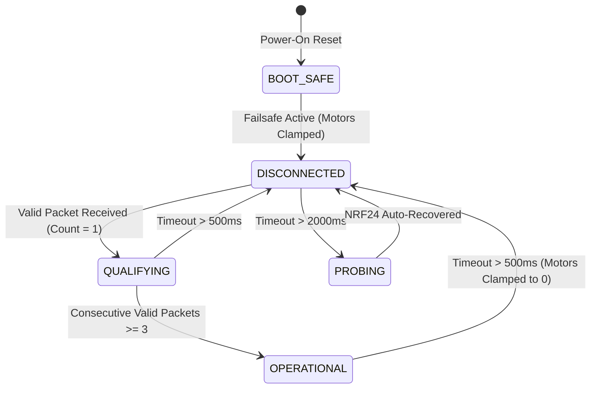

# 🚨 CYBERROVER X5 — FAILSAFE & FAULT SPECIFICATION (FIRMWARE v1.5)

**Document Classification:** Vehicle Safety & Hazard Mitigation Specification  
**Lead Architect & Developer:** Veer Pratap Saw (Veer) | Class 10 Student, Katras / Ramgarh, Jharkhand  

---

## 1. Safety Directive & Threat Model

A $12\text{ kg}$ reconnaissance vehicle traveling at up to $11.31\text{ km/h}$ poses severe physical hazards if a loss of communication results in "runaway motor" condition. The CyberRover X5 failsafe policy enforces **deterministic, autonomous safe-state engagement** directly on the receiver node without requiring assistance from the remote transmitter.

---

## 2. Failsafe State Machine Specification



### State Definitions:

1. **BOOT_SAFE (Power-On Initialization):**
   * Default state upon power-up.
   * Both motor drive channels are clamped to neutral ($0\text{ PWM}$).
   * Arming flag `is_armed` is forced to `false`.

2. **DISCONNECTED / FAILSAFE ENGAGED:**
   * Entered whenever $now - \text{lastValidPacketTime} > 500\text{ ms}$.
   * **Motor Actions:**
     $$\text{throttle\_norm} = 0$$
     $$\text{steering\_norm} = 0$$
     $$\text{is\_armed} = \text{false}$$
   * **Visual Indicator:** Onboard LED (`PC13`) is held `HIGH` (OFF).
   * **Telemetry:** Serial logs `[ALERT] RF LINK LOST! NO PACKET FOR >500ms -> FAILSAFE ENGAGED`.

3. **RECONNECTION QUALIFICATION GUARD:**
   * A single isolated RF packet arriving after a link drop is **insufficient** to unclamp motor power (prevents twitching during intermittent signal flutter).
   * The receiver requires **3 consecutive valid, uncorrupted, fresh packets** ($\sim 75\text{ ms}$) before transitioning back to `OPERATIONAL`.

4. **OPERATIONAL (Active Closed-Loop Driving):**
   * Verified control packets are translated into normalized motor commands:
     $$\text{throttle\_norm} \in [-1000, +1000]$$
     $$\text{steering\_norm} \in [-1000, +1000]$$
   * Applied only if `RoverPacket.toggle_l == 1` (Master Arm switch in `DRIVE`). If `toggle_l == 0`, motors remain in `PARK` ($0\text{ PWM}$).

---

## 3. Background Silicon Auto-Recovery

If the radio link remains absent for over $2000\text{ ms}$:
* The receiver executes `checkBackgroundRecovery()`.
* It verifies `radio.isChipConnected()` at a rate-limited cadence ($1\text{ probe every } 2000\text{ ms}$).
* If an electrical disconnect or LDO brownout caused Nordic register corruption, the driver re-initializes the SPI registers and resumes listening without requiring manual MCU reset buttons or power cycling.

---

## 4. Motor Driver Interface (`RoverMotorCommand`)

The receiver firmware exposes a structured interface ready to drive dual BTS7960 43A MOSFET H-bridges:

```cpp
struct RoverMotorCommand {
  int16_t throttle_norm;   // -1000 (Full Reverse) to +1000 (Full Forward)
  int16_t steering_norm;   // -1000 (Full Left) to +1000 (Full Right)
  bool    is_armed;        // true = Motors Active ('D'), false = Parked ('P')
  bool    failsafe_active; // true = Signal Lost, Neutral Enforced
  uint32_t failsafe_count; // Lifetime counter of failsafe activations
};
```
