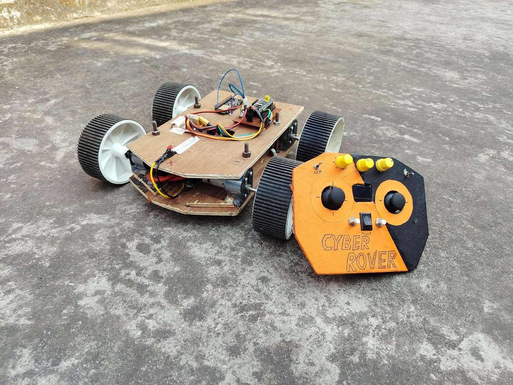
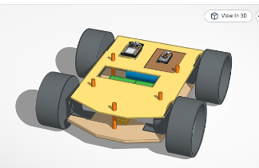
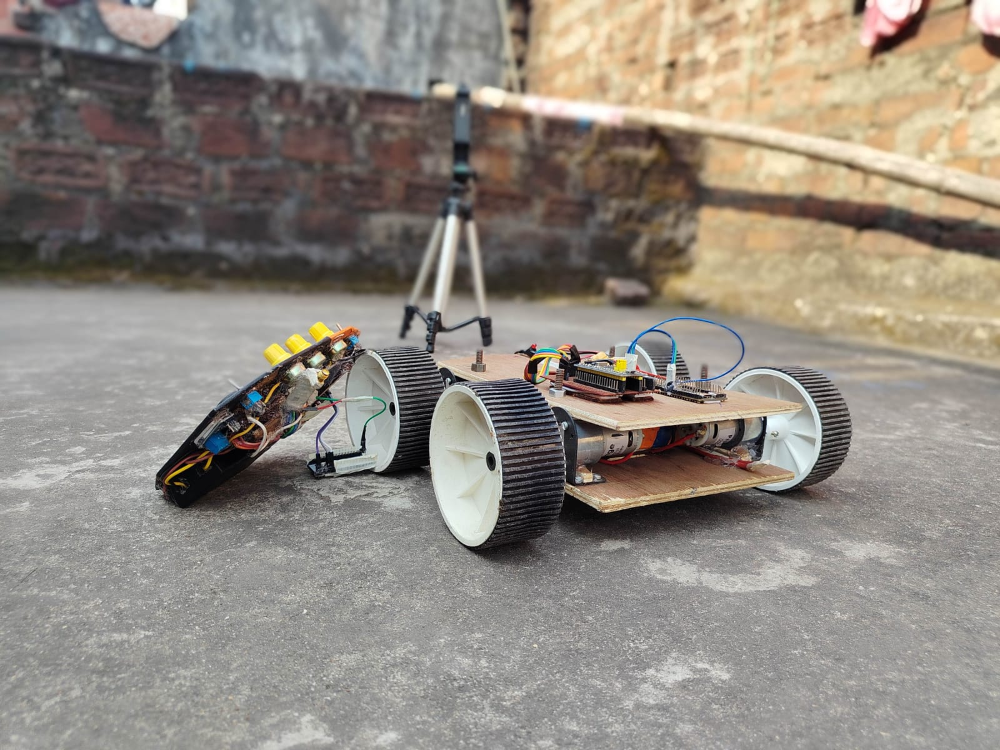

# 🤖 HOW TO BUILD CYBERROVER X5
### *The Complete, Practical Builder's Guide — From Zero to a Working UGV*



> **Welcome, Builder! 👋**  
> My name is **Veer Pratap Saw**, an independent robotics architect from Katras / Dhanbad, Jharkhand, India.  
> In under 1 year, I went from building cardboard prototypes to winning **1st Prize in the State-Level Science Championship** with this rover architecture.  
> 
> You **do not need** an expensive 3D printer, a high-tech workshop, or thousands of dollars to create world-class robotics. All you need is everyday plywood, reliable geared motors, basic electronics, and an **Agentic AI pair programmer** sitting beside you at your computer!

> ### 📐 Interactive 3D CAD Model (Public on Tinkercad)
> Want to see the exact 3D design of the car before you start cutting wood? Rotate it, inspect the motor brackets, and check every angle directly in your browser:  
> 
> [](https://www.tinkercad.com/things/4SGPQKu9c76-fighter-cyberrover-x5)  
> 👉 **[Click Here to Open: fighter cyberrover x5 on Tinkercad (Free 3D Viewer)](https://www.tinkercad.com/things/4SGPQKu9c76-fighter-cyberrover-x5)**

> ### 🛒 Where to Buy All the Hardware: 100% Sourced from [Robu.in](https://robu.in)
> You can buy **all mechanical and electrical components** directly from **[Robu.in](https://robu.in)** at the exact prices listed in [`BOM.md`](BOM.md). Veer personally purchased all the motors, steel brackets, 100mm wheels, BTS7960 drivers, microcontrollers, and power modules from Robu.in!

---

## ⚡ 1. The Real Commitment: Consistency & 80 Hours

```
┌──────────────────────────────────────────────────────────────────────────────────┐
│ THE 7-DAY / 80-HOUR BUILD REALITY                                                │
├──────────────────────────────────────────────────────────────────────────────────┤
│ Total Build Time : ~80 Hands-on Engineering Hours                                │
│ Calendar Window  : ~7 Days of Focused Building                                   │
│ Mindset Required : Daily Consistency & Step-by-Step Patience                     │
└──────────────────────────────────────────────────────────────────────────────────┘
```

Building real, high-power hardware requires steady discipline:
* **Hardware takes patience:** Wires will come loose, motors need solid bracket alignment, and solder joints take practice.
* **Consistency beats talent:** Spending 3 to 4 focused hours each day will take you from a bare sheet of plywood to a working, high-speed autonomous ground vehicle in roughly **7 to 10 days**.
* **Don't give up when a bug appears:** Every error is simply a clue. When a motor does not spin or a sensor drops out, treat it as a puzzle to solve together with your AI assistant.

---

## 📸 The Completed Machine & Transmitter

<p align="center">
  
  
</p>

* **The Rover Chassis:** Dual plywood decks separated by 4 threaded steel rod uprights with locknuts. The 45° beveled nose easily climbs over obstacles, steps, and ramps.
* **The Handheld Transmitter:** Custom-cut MDF enclosure finished in industrial safety orange and stealth matte black with a live 1.3" OLED pilot telemetry screen, dual analog gimbals, and 3 knurled dials.

---

## 🚀 2. Machine Performance at a Glance

* **Speed:** Reaches almost **$12\text{ km/h}$** ($3.30\text{ m/s}$) on 100mm wheels — exceptionally fast for an off-road ground rover!
* **High-Torque Push Force:** 4x Johnson 600 RPM motors generate **$97.6\text{ Newtons}$ of linear thrust** (~$10\text{ kg-f}$), easily towing rolling trailers over $20\text{ kg}$.
* **Agility & Stunts:** Capable of instant $360^\circ$ in-place tank spins, high-speed power drifts, ramp climbing, and surviving height drops.
* **Low-Latency Wireless:** Runs a dedicated 50 Hz zero-drop ESP-NOW link (Channel 1, 0ms modem wake-up latency) with real-time battery voltage and speed telemetry returned to the handheld HUD.

---

## 🛠️ 3. The 4 Core Build Phases

```
┌────────────────────────────────────────────────────────────────────────┐
│                   STEP-BY-STEP CONSTRUCTION BLUEPRINT                  │
├────────────────────────────────────────────────────────────────────────┤
│ 1. CHASSIS & FRAME                                                     │
│    Cut two matching decks from 6mm to 8mm plywood with a hand saw.     │
│    Join them using four 8mm threaded steel rods with double locknuts.  │
├────────────────────────────────────────────────────────────────────────┤
│ 2. DRIVETRAIN & WHEELS                                                 │
│    Bolt 4x Johnson 12V 600 RPM geared motors to the bottom deck using │
│    heavy-duty EasyMech steel brackets. Press on 100mm rubber wheels.   │
├────────────────────────────────────────────────────────────────────────┤
│ 3. BRAIN & POWER ELECTRONICS                                           │
│    Mount dual BTS7960 43A MOSFET drivers, an STM32 Blue Pill, and an   │
│    ESP32-S3 wireless bridge. Power with a 3S 2200 mAh drone LiPo.      │
├────────────────────────────────────────────────────────────────────────┤
│ 4. HANDHELD REMOTE CONTROLLER                                          │
│    Assemble a 170x125x42mm box from 2mm MDF. Wire 2 analog gimbals,    │
│    3 rotary potentiometers, switches, an OLED screen, and an ESP32.    │
└────────────────────────────────────────────────────────────────────────┘
```

---

## 🧠 4. How to Use Agentic AI to Build This With You

You do not need to memorize complex microcontroller registers or spend months learning C++ firmware architecture.  
**CyberRover X5 was designed and coded collaboratively using an "Agentic AI".**

### What is an "Agentic AI"?
Unlike a basic chatbot that only replies with generic text, an **Agentic AI** (such as Google Antigravity, Cursor, or Windsurf) inspects the entire project folder, reads the exact pinouts, analyzes circuit voltages, debugs compilation errors, and guides you step-by-step like a senior engineering mentor sitting at your desk!

---

## 💻 5. Opening This Workspace in AI Software

You can open this repository in any modern agentic coding environment:

### Option A: Google DeepMind Antigravity IDE (Recommended)
1. Launch **Antigravity**.
2. Click **File** ➔ **Open Folder...** ➔ Select the `cyberrover X5` directory.
3. Open the chat panel to interact with the agent.

### Option B: Cursor IDE
1. Download **Cursor** from [cursor.com](https://www.cursor.com).
2. Click **File** ➔ **Open Folder...** ➔ Select `cyberrover X5`.
3. Press `Ctrl + L` (Windows/Linux) or `Cmd + L` (Mac) to open the AI Chat window.

### Option C: VS Code with Cline, Roo Code, or GitHub Copilot
1. Open **VS Code**.
2. Click **File** ➔ **Open Folder...** ➔ Select `cyberrover X5`.
3. Open the Cline or Copilot chat sidebar.

### Option D: Windsurf IDE
1. Download **Windsurf** from [codeium.com/windsurf](https://codeium.com/windsurf).
2. Open the `cyberrover X5` folder.
3. Open **Cascade** (the AI conversation window).

---

## 💬 6. The Universal Prompt for Your AI Assistant

Once you open this folder in your AI software, **copy and paste this exact prompt into the chat window**:

```text
Hi! I want to build the CyberRover X5 from scratch.

Please read `AGENTS.md` and all files in the `ai/` folder first.

You are my personal robotics engineering mentor and pair programmer.
Explain everything in clear, friendly English without unnecessary academic jargon.
Guide me step-by-step from zero to a finished, fully operational ground rover.

Start by asking me what tools, workshop materials, and electronic parts I currently have on my desk!
```

### What Happens Automatically:
* The AI will read [`ai/AGENTS.md`](ai/AGENTS.md), [`ai/AI_CONTEXT_HANDOFF.txt`](ai/AI_CONTEXT_HANDOFF.txt), and [`ai/CYBERROVER_MASTER_KNOWLEDGE_BASE.md`](ai/CYBERROVER_MASTER_KNOWLEDGE_BASE.md).
* It will understand every motor driver pin, voltage divider value, and radio timing parameter.
* It will work through your build step-by-step, helping you wire, assemble, test, and flash your microcontrollers with zero guesswork!

---

## ⚔️ 7. Competition & RoboFight Capabilities

If you are entering robotics tournaments, combat challenges, or tech exhibitions, this platform delivers decisive advantages:

1. **Heavy Ground Grip:** Weighing $2.4\text{ kg}$ on wide ribbed rubber wheels, lighter competitors cannot push or displace it.
2. **Surplus Motor Thrust:** The 4 Johnson motors deliver $97.6\text{ N}$ of stall push force, enabling it to shove obstacles or competing robots weighing over $15\text{ kg}$.
3. **Steel Armor & Shock Absorption:** The EasyMech steel motor mounts protect the gearboxes from heavy lateral impacts and jump landings.
4. **Sub-300ms Throttle Punch:** Accelerates from full stop to sprint speed in $0.26\text{ seconds}$ (`ACCEL_STEP = 8.0f` = 800 PWM/s), enabling fast tactical maneuvers, aggressive rams, and evasive dodges.

---

## ⚠️ 8. Workshop Safety First

* **Cutting & Tools:** When cutting plywood with a handsaw or utility knife, always clamp your work securely and wear protective eyewear.
* **Soldering:** Work in a well-ventilated area. Never leave a hot soldering iron unattended.
* **Battery Safety:** Drone LiPo batteries store high energy density. Use an authentic balance charger (such as B3 or B6), never short-circuit the leads, and stop driving when the pack voltage drops to $10.5\text{V}$ (3.5V per cell).

---

## 🤝 9. The Open Source Philosophy

This project is released **100% open source** to demonstrate what is achievable with everyday materials, standard electronic components, and an AI engineering partner. 

Take the plans, adapt the dimensions, improve the software, and build your own high-performance autonomous machines! 🚀

---

## 📚 Essential Companion Guides
* 📱 **[Phone & PC Coding Requirements](REQUIREMENTS.md):** How to code, flash, and test using an ordinary ₹5,000 Android smartphone with OTG!
* 🧾 **[Bill of Materials (BOM) & Salvage Hacks](BOM.md):** Full component list and how to get parts for under ₹500.
* ⚠️ **[What NOT to Do (Rookie Traps Guide)](WHAT_NOT_TO_DO.md):** Avoid the generic ChatGPT trap, voltage brownouts, and loose wiring pitfalls!

